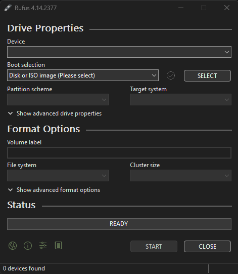
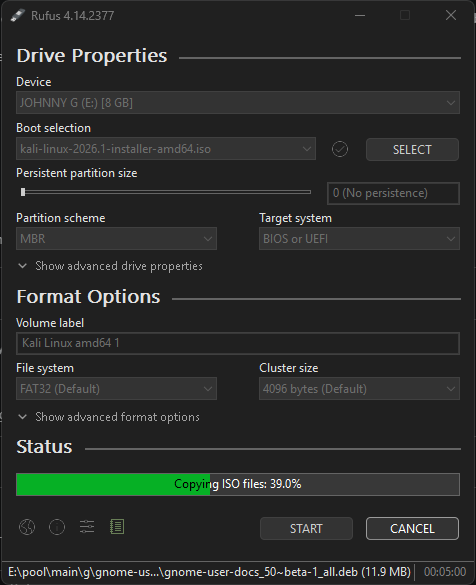

# 💽 01 - USB Bootable Creation

## 📌 Overview

This document describes the process of creating a bootable USB device for operating system installation and homelab deployments.

Bootable USB devices are commonly used for:

- 🐧 Linux installations
- 🪟 Windows deployments
- 🧪 Virtualization labs
- ☁️ Cloud engineering practice
- 🛠️ System recovery
- 🔐 Security testing environments

This lab uses Rufus to create bootable media from ISO images.

---

# 🎯 Objectives

- 📥 Download official operating system images
- 💽 Create a bootable USB device
- 🖥️ Prepare installation media for multiple operating systems
- 🧪 Understand common ISO image types

---

# 🧰 Requirements

| Requirement | Details |
|---|---|
| 💾 USB Drive | Minimum 8 GB |
| 🖥️ Windows System | Required for Rufus |
| 🌐 Internet Connection | Required |
| 🛠️ Rufus | USB imaging utility |

---

# 🛠️ Download Rufus

Official website:

https://rufus.ie/en/

## 📌 About Rufus

Rufus is a lightweight utility used to create bootable USB devices from ISO images.

Common use cases:

- Windows installation media
- Linux installation media
- Recovery environments
- Firmware flashing
- Troubleshooting systems

!- rufus-homepage.png -!

---

# 📀 Understanding ISO Images

Different operating systems provide multiple ISO image types depending on the deployment scenario.

---

# 🪟 Windows Images

## Common Windows Installation Images

| Image Type | Purpose |
|---|---|
| Windows 11 ISO | Standard desktop installation |
| Windows 10 ISO | Legacy and compatibility systems |
| Windows Server ISO | Enterprise server environments |

## Official Microsoft Downloads

- Windows 11
- Windows 10
- Windows Server

!- windows-iso-download.png -!

---

# 🐧 Linux Images

## Common Linux Distribution Images

| Distribution | Purpose |
|---|---|
| Ubuntu | General-purpose Linux |
| Debian | Stable server environments |
| Kali Linux | Security and penetration testing |
| Fedora | Development and enterprise |
| Rocky Linux | Enterprise server replacement |
| Arch Linux | Advanced custom environments |

---

# 🐉 Kali Linux Images

Official website:

https://www.kali.org/get-kali/#kali-installer-images

## 📌 Common Kali Image Types

| Image | Purpose |
|---|---|
| Installer Image | Full operating system installation |
| Live Image | Run Kali without installation |
| Virtual Machines | VMware / VirtualBox environments |
| ARM Images | Raspberry Pi and ARM devices |
| Cloud Images | Cloud provider deployments |

!- kali-download-page.png -!

---

# ✅ Recommended Image For This Lab

| Setting | Value |
|---|---|
| Distribution | Kali Linux |
| Image Type | Installer Image |
| Architecture | 64-bit |

---

# ⚙️ Creating Bootable USB With Rufus

## 1️⃣ Insert USB Device

Connect the USB drive to the workstation.

> ⚠️ Warning:
> All existing data on the USB device will be erased.

---

## 2️⃣ Launch Rufus

Run Rufus with administrative privileges.



---

## 3️⃣ Configure Rufus

Select the following:

| Setting | Value |
|---|---|
| 💽 Device | USB Drive |
| 📀 Boot Selection | ISO Image |
| 🧱 Partition Scheme | GPT |
| 🖥️ Target System | UEFI |
| 📂 File System | FAT32 |

---

## 4️⃣ Select ISO Image

Click:

```text
SELECT
```

Choose the downloaded ISO file.

Example:

```text
kali-linux-2026-installer-amd64.iso
```

---

## 5️⃣ Start Imaging Process

Click:

```text
START
```

Wait until Rufus finishes writing the image.



---

# 🚀 Boot Process

Restart the target system and open the Boot Menu.

## ⌨️ Common Boot Keys

| Vendor | Key |
|---|---|
| Dell | F12 |
| HP | ESC / F9 |
| Lenovo | F12 |
| ASUS | ESC |
| Acer | F12 |

---

# ✅ Verification

Successful configuration should display the operating system installer menu during boot.


---

# 🧰 Troubleshooting

## ❌ USB Device Not Detected

Possible causes:

- Faulty USB drive
- Corrupted ISO
- USB formatting issues

---

## ❌ System Does Not Boot From USB

Possible causes:

- Secure Boot enabled
- Incorrect partition scheme
- BIOS boot order

---

## ❌ Rufus Fails During Imaging

Possible solutions:

- Re-download ISO
- Use another USB device
- Run Rufus as administrator

---

# 📖 References

- https://rufus.ie/en/
- https://www.kali.org/get-kali/#kali-installer-images
- https://ubuntu.com/download
- https://www.microsoft.com/software-download/